# Wireshark SOC Labs: Week 1 Extra Project

**Networkwalks Cybersecurity Internship · Batch B084 · Week 1 · PM4 (Wireshark, Extra)**
**Author:** Mubassir

I played the role of a SOC analyst and investigated 6 packet captures in the Networkwalks browser labs. Each lab has 10 tasks. I used Wireshark display filters, Statistics, Follow TCP Stream and the Telephony tools to find an attacker, hidden data, plain-text passwords, a brute-force attack and a scam call.

> **Safe-use note:** All work was done inside the provided lab environment. No real network was captured or tested. Passwords and codes found in the labs are masked in the screenshots and not written in this README.

---

## Summary

| Lab | Topic | What I found | Score |
|-----|-------|--------------|-------|
| 3 | Identify the Attacker's IP | TCP SYN port scan of a web server | 90/100 |
| 4 | Follow TCP Stream 1 | Passwords shared in a plain-text office chat | 80/100 |
| 5 | Follow TCP Stream, Part 2 | Secret note hidden in an HTML comment | 100/100 |
| 6 | HTTP Plain Text Credentials | Login sent over HTTP, readable in packets | 100/100 |
| 7 | Catch the Brute Force Attacker | FTP password guessing, 24 failures then 1 success | 100/100 |
| 8 | Catch the Call Scammer | SIP/RTP scam call that asked for card details | 100/100 |

(Lab numbers match the Networkwalks lab links, `wireshark-lab3` to `wireshark-lab8`.)

## Filters used across the labs

| Goal | Display filter |
|------|----------------|
| Packets with the SYN flag set | `tcp.flags.syn == 1` |
| One host's traffic | `ip.addr == <ip>` |
| One TCP port | `tcp.port == <port>` |
| All web requests and responses | `http` |
| Form submissions (logins) | `http.request.method == "POST"` |
| Failed FTP logins | `ftp.response.code == 530` |
| Successful FTP logins | `ftp.response.code == 230` |
| VoIP call setup | `sip.Method == "INVITE"` |
| Voice packets | `rtp` |

---

## Lab 3: Identify the Attacker's IP

**Scenario:** A staff member reported unusual traffic to the company web server.

**Method**
1. Captured the traffic (309 packets).
2. Applied `tcp.flags.syn == 1` (73 packets displayed) and scrolled the Source column. One host sent a long block of SYN packets from about 3.4 s onward.
3. Filtered that host with `ip.addr == 192.168.10.66`. It first sent an ICMP ping to the server, then started the scan.
4. Read the Info column. The source port stayed the same (52311) while the destination port changed in every packet.
5. Open ports answered with `SYN, ACK`. Closed ports answered with `RST, ACK`.

**Findings**
- Attacker: `192.168.10.66`, target (web server): `192.168.10.20`
- Ports probed: 40. Open: 22, 80, 443. Closed: 37.
- Attack type: **TCP SYN port scan** (reconnaissance, MITRE ATT&CK T1046).

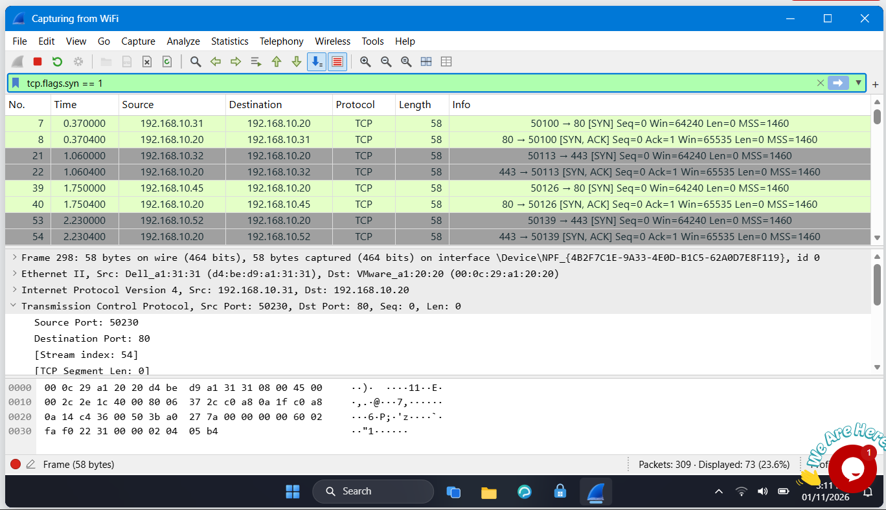
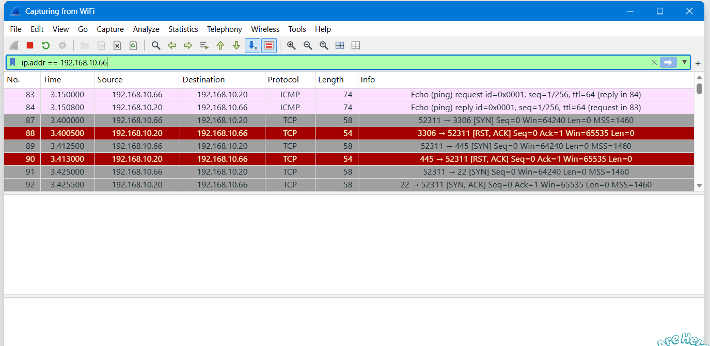

**Defence:** Firewall rules and an IDS that alerts on many SYNs from one source in a short time.

---

## Lab 4: Follow TCP Stream 1

**Scenario:** Staff use an old chat tool. Find the chat and read it.

**Method**
1. Opened **Statistics → Conversations → TCP** and ignored ports 80 and 443. One conversation used port **5000**.
2. Applied `tcp.port == 5000` (24 packets). The first SYN came from `192.168.10.45`, so that host started the chat.
3. Right-click a data packet → **Follow → TCP Stream**. The window title showed `tcp.stream eq 5` and the conversation size was 413 bytes.

**Findings**
- Chat port 5000, stream 5, 413 bytes.
- Client text is red and server text is blue.
- An IT person sent a temporary password and the guest Wi-Fi password in clear text (masked in the screenshot).

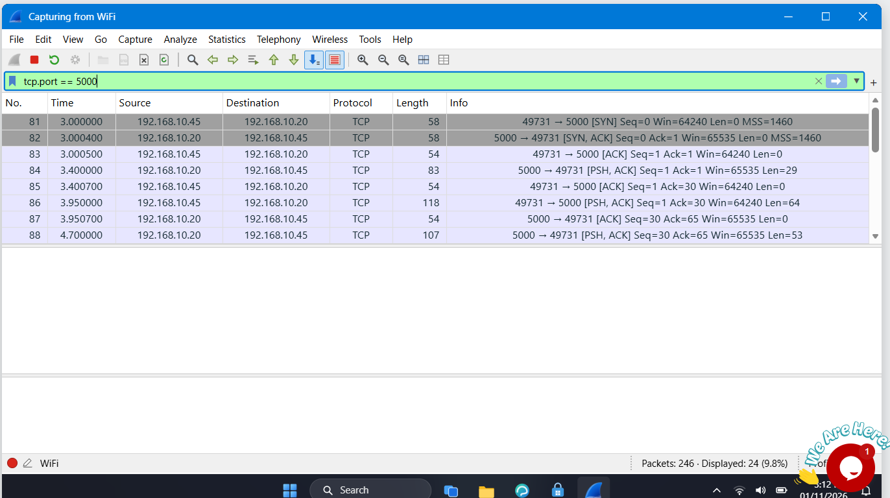
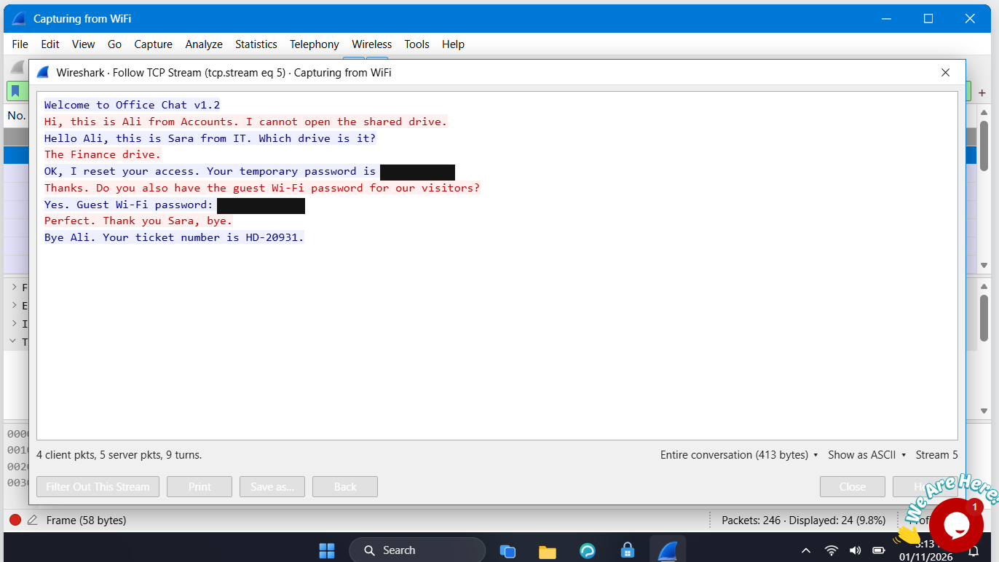

**Defence:** Use an encrypted chat tool (TLS), and never send passwords in chat.

---

## Lab 5: Follow TCP Stream, Part 2

**Scenario:** An admin said one intranet page has a hidden note.

**Method**
1. Applied `http` and listed the pages one staff PC requested.
2. Compared response sizes. `/staff.html` was the largest, so I followed its stream (stream 7).
3. The note was inside an **HTML comment** (`<!-- ... -->`). Browsers do not show comments, but they travel in the packet.

**Findings**
- Hidden in `/staff.html`, status code 200, server to client.
- The comment exposed a backup server address and an access code (masked in the screenshot).
- The same PC also downloaded `report.txt`, and Follow TCP Stream showed its contents.

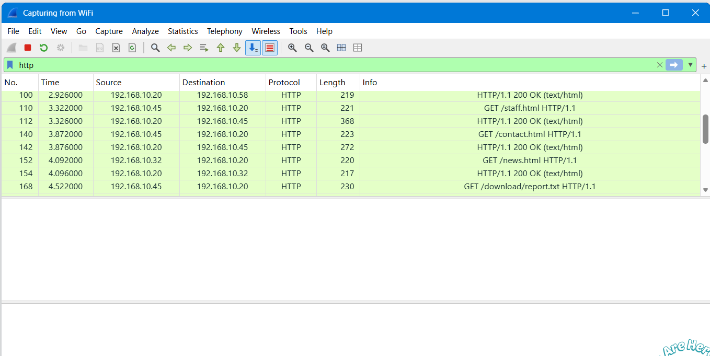
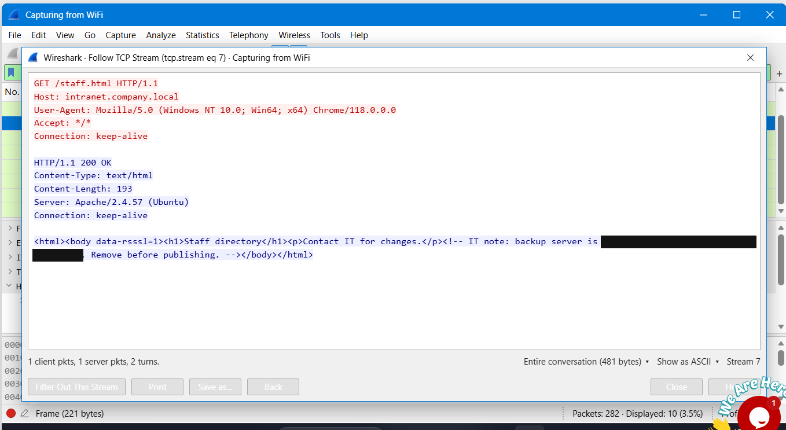

**Defence:** Never leave notes or secrets in page source. Remove comments before publishing.

---

## Lab 6: HTTP Plain Text Credentials

**Scenario:** Find usernames and passwords sent in clear text.

**Method**
1. Captured 255 packets. The protocol was HTTP.
2. Applied `http.request.method == "POST"` and found 2 login requests to `/login` from `192.168.10.45`.
3. In the packet details, the **HTML Form URL Encoded** line showed the username and password.
4. **Follow → TCP Stream** (stream 4) showed both attempts: the first failed ("Invalid username or password") and the second succeeded ("Welcome back").

**Findings:** Credentials for one user travelled unencrypted. Anyone on the network could read them.

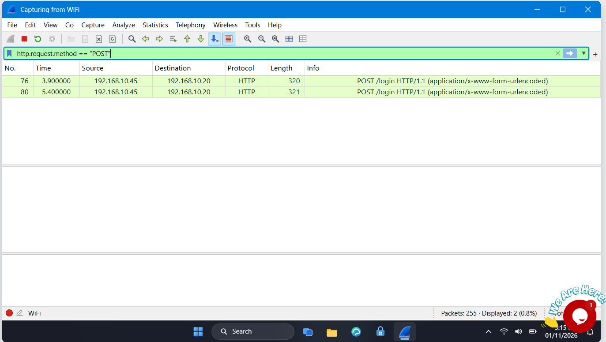
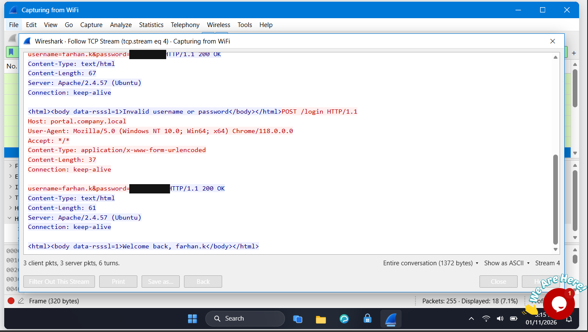

**Defence:** Use HTTPS for every login page.

---

## Lab 7: Catch the Brute Force Attacker

**Scenario:** Find who is guessing passwords.

**Method**
1. Captured 369 packets. The repeated logins were **FTP** to `192.168.10.20`.
2. `ftp.response.code == 530` showed **24** "Login incorrect" replies, all to `192.168.10.66`.
3. `ftp.response.code == 230` showed exactly **one** "Login successful" at frame 284, to the same host.
4. The attacker kept trying passwords for the `admin` account until one worked.

**Findings:** Attacker `192.168.10.66`, 24 failed logins, then a success. Attack type: **brute force**.

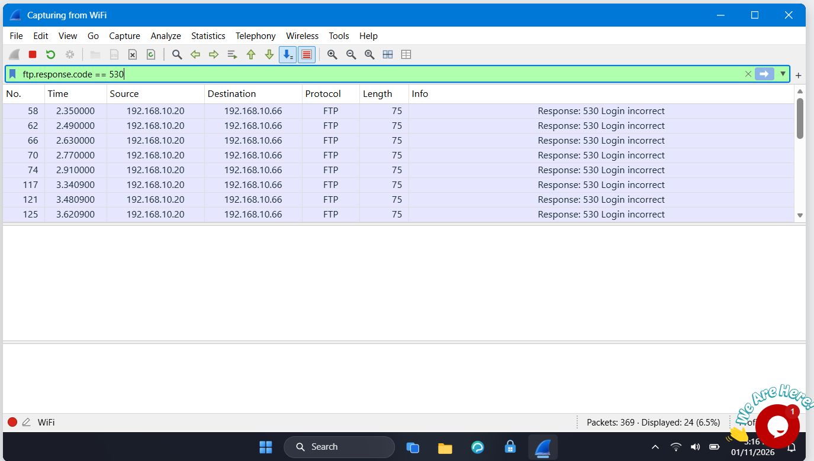
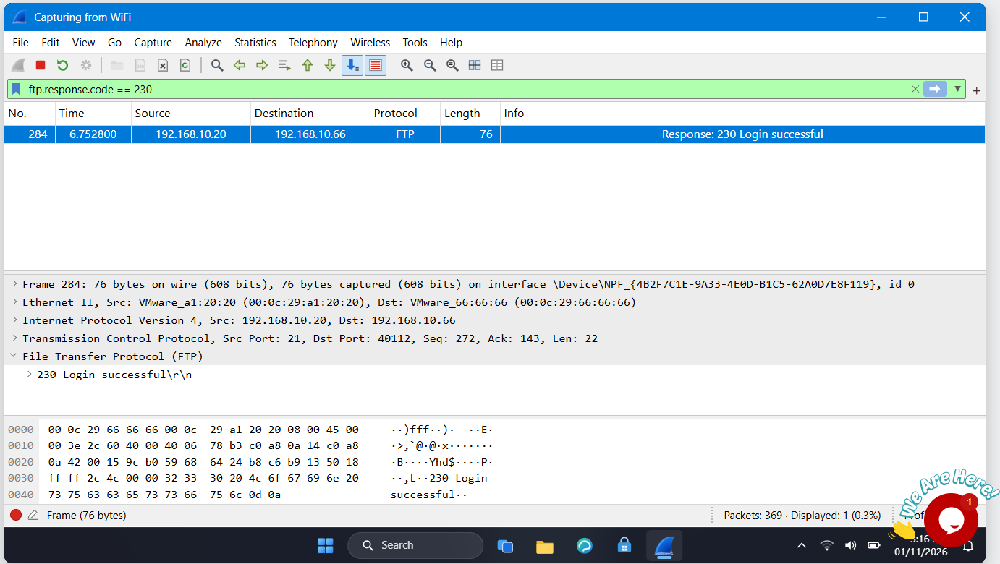

**Defence:** Account lockout, rate limiting, strong passwords, MFA, and SFTP instead of FTP.

---

## Lab 8: Catch the Call Scammer

**Scenario:** Investigate a phone call, play it back and identify the scammer.

**Method**
1. Captured 1051 packets. Call setup used **SIP** and the voice used **RTP**.
2. `sip.Method == "INVITE"` showed the call from `192.168.10.45` to extension 202 on `192.168.10.52` (UDP 5060). The SIP header gave the caller's extension and name.
3. `rtp` showed 804 voice packets in two directions (two SSRC values). The codec was **G.711 PCMU**.
4. **Telephony → VoIP Calls → Play Streams** let me hear who answered and the card details the scammer asked for (not written here).

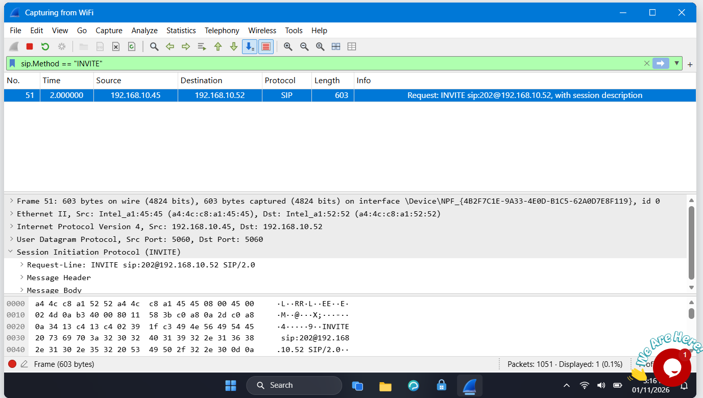
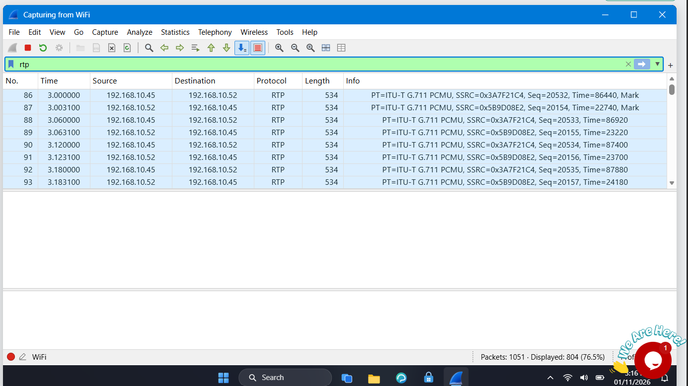

**Defence:** Encrypt calls with SRTP and train staff never to give card details by phone.

---

## Troubleshooting experience

**Problem 1: filter errors when searching packet contents.**
In Lab 5 I tried to search the HTTP responses for the hidden note with filters like `frame contains "<!--"` and got the error *"frame is a protocol, not a field"*. Other variants were also rejected.

**Solution:** I stopped fighting the filter bar and used other Wireshark tools:
1. Compared response sizes in the packet list. The page with the hidden note was the largest.
2. Opened that response with **Follow → TCP Stream** and read the page.
3. Used **Ctrl+F** with *Packet bytes* and *String* to search for `<!--`.

**Problem 2: wrong answer on "Show only SYN packets" (Lab 3).**
I used `tcp.flags.syn == 1 && tcp.flags.ack == 0`. That shows only connection starts (the scan's 40 SYNs plus other hosts), but the lab counts every packet with the SYN flag set, including `SYN, ACK` replies, which is 73. The simple filter `tcp.flags.syn == 1` gave the right number.

**Lesson:** Read the question exactly, and match the filter to the wording. If a filter is rejected or the count looks off, check the flags, the field name and the Wireshark version, and fall back on Follow Stream, Find and Statistics.

---

## Skills practised
Wireshark display filters, Statistics (Conversations), Follow TCP/HTTP stream, SYN scan detection, plain-text credential analysis, brute-force detection, VoIP (SIP/RTP) analysis, writing security recommendations.

## Repository contents
```
README.md
screenshots/   12 screenshots, 2 per lab (lab3-... to lab8-...)
```
